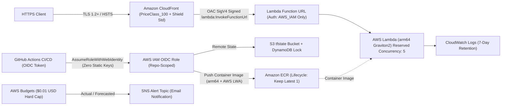

# Cloud Foundation

Central multi-project **Infrastructure as Code (IaC)** and **Policy-as-Code** repository powering an **AWS Always-Free ($0.00/month)** serverless cloud architecture for containerized FastAPI microservices (`vinum-pulse`, `finops-sentinel`, `aegis-mcp`).

> **FinOps & Zero-Trust Guarantee**: Every Terraform stack is statically gated by **OPA/Rego** (`conftest` + `opa test`), **Trivy**, and **TFLint** to block paid AWS primitives (NAT Gateways, ALBs, RDS, EKS, Fargate), forbid static IAM keys, and enforce CloudFront Origin Access Control (SigV4) in front of `AWS_IAM`-protected Lambda Function URLs.

---

## Architecture Overview



---

## Monthly Cost Breakdown (AWS Always-Free)

| AWS Service | Configuration | Free Tier Quota | Projected Cost |
| :--- | :--- | :--- | :---: |
| **Amazon CloudFront** | `PriceClass_100`, OAC SigV4, Shield Standard | 1 TB transfer + 10M requests/mo (Always Free) | **$0.00** |
| **AWS Lambda** | `arm64` Graviton2, container image, concurrency cap = 5 | 1M requests + 400,000 GB-s/mo (Always Free) | **$0.00** |
| **Amazon ECR** | Private repo, scan-on-push, lifecycle = latest 1 image | 500 MB storage/mo (12-mo / negligible post-tier) | **$0.00** |
| **Amazon S3 + DynamoDB** | Remote `tfstate` (AES256, 30d noncurrent expiry) + lock table | 5 GB S3 / 25 GB DynamoDB (Always Free) | **$0.00** |
| **IAM OIDC + AWS Budgets** | 1 OIDC provider + 1 SNS budget alarm (`$0.01`) | 2 free budgets/mo, IAM is free | **$0.00** |
| **Total** | **Multi-project portfolio foundation** | **Enforced via OPA/Rego CI** | **$0.00 / mo** |

---

## Repository Structure

| Path | Description |
| :--- | :--- |
| `stacks/00-bootstrap/` | Remote S3 state bucket (AES256, versioned, public-blocked) + DynamoDB `PAY_PER_REQUEST` lock table |
| `modules/account-guardrails/` | Reusable account-level security & FinOps module (GitHub OIDC provider, least-privilege IAM role, `$0.01` AWS Budget + SNS) |
| `stacks/10-account-security-finops/` | Root stack instantiating `modules/account-guardrails` for `AlejandroCasa/*` repositories |
| `modules/fastapi-zero-cost-app/` | DRY microservice module: ECR + Graviton2 Lambda + `AWS_IAM` Function URL + CloudFront OAC + Security Headers |
| `stacks/20-services/vinum-pulse/` | Isolated service stack for `vinum-pulse` (`VINUM_DB_PATH=/tmp/vinum_pulse.db`, `AWS_LWA_PORT=8000`) |
| `stacks/20-services/finops-sentinel/` | Isolated service stack for `finops-sentinel` |
| `stacks/20-services/aegis-mcp/` | Isolated service stack for `aegis-mcp` |
| `policy/` | OPA/Rego FinOps Free-Tier & Zero-Trust Security policies + Rego unit tests |
| `docs/AWS-ZERO-COST-BOOTSTRAP.md` | Step-by-step Spanish (`es-ES`) guide to bootstrap a brand-new AWS account safely |

---

## Local Static Validation (Zero AWS Credentials Required)

```bash
# 1. Format check
docker run --rm -v "$PWD:/work" -w /work hashicorp/terraform:1.9 fmt -check -recursive

# 2. Policy-as-Code unit tests (OPA)
docker run --rm -v "$PWD:/work" -w /work openpolicyagent/opa:latest test /work/policy -v

# 3. Static IaC policy check (Conftest)
docker run --rm -v "$PWD:/work" -w /work openpolicyagent/conftest:latest test --policy /work/policy modules stacks

# 4. IaC security misconfiguration scan (Trivy)
docker run --rm -v "$PWD:/work" -w /work aquasec/trivy:latest config --exit-code 1 --severity HIGH,CRITICAL /work
```

---

## Bootstrap & Deployment Guide

Follow [docs/AWS-ZERO-COST-BOOTSTRAP.md](docs/AWS-ZERO-COST-BOOTSTRAP.md) for the complete manual sequence from creating a new AWS account with Root MFA to enabling GitHub Actions OIDC deployments.
